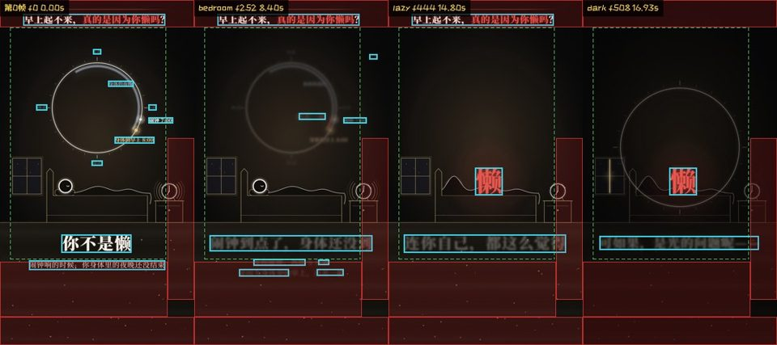

# video-lint

[](https://github.com/tz1335/video-lint/actions/workflows/ci.yml)

**Deterministic QA for finished short videos.** Point it at an mp4 and it checks the first frame and first two seconds, black and frozen stretches, text under TikTok / Reels / Shorts UI zones, cut-on-beat timing, loudness, and whether sound effects are buried under the music. It writes a human report, a JSON report for agents, and contact sheets. No model calls: same input, same answer.

**短视频成片质检，规则全是确定性的。** 给它一个 mp4，它会查第 0 帧和前 2 秒、黑场和静止画面、字幕有没有被抖音（TikTok）/ Reels / Shorts 的界面挡住、硬切卡不卡拍、响度，以及音效有没有被配乐盖住。输出给人看的报告、给 agent 读的 JSON 报告和联系表。不调用任何模型：同样的输入，永远得到同样的结论。

It started inside a Remotion project that makes short explainer videos; every rule comes from a real published video and its retention data (the reasons are written next to each rule in `lint.py`).

它最早是在一个用 Remotion 做知识短视频的工程里写出来的。每一条规则都来自一支真实发布过的视频和它的留存数据，`lint.py` 里每条规则旁边都写了来由。

## Install · 安装

```bash
pipx install "video-lint[ocr] @ git+https://github.com/tz1335/video-lint@v0.5.0"
video-lint final.mp4
```

`[ocr]` adds RapidOCR for the text checks on any video; drop it for a lighter install. `[beats]` adds librosa for estimating the beat grid from audio, `[mcp]` the MCP server; `[all]` installs everything. Plain `pip install` works the same way. Requires `ffmpeg` / `ffprobe` on PATH.

`[ocr]` 会装上 RapidOCR，对任何视频都能做文字检查；不要的话去掉它，装起来更轻。`[beats]` 装 librosa，用来从音频估拍子网格；`[mcp]` 装 MCP 服务；`[all]` 全都装。用普通的 `pip install` 也一样。需要 `ffmpeg` / `ffprobe` 在 PATH 里。

Without installing, from a clone: `pip install -r requirements.txt`, then `python -I lint.py final.mp4`.

不想安装的话，克隆仓库后 `pip install -r requirements.txt`，再 `python -I lint.py final.mp4` 也能跑。

## Quick start · 快速开始

```bash
video-lint final.mp4                                   # report in final-lint/
video-lint final.mp4 --platform tiktok --lufs -14 --strict
video-lint final.mp4 --captions final.srt          # caption reading speed and opening line · 字幕阅读速度和开头第一句
video-lint final.mp4 --sidecar examples/sidecar.example.json --out report/
```



*Part of a contact sheet: Douyin's UI zones in red, the recommended safe area dashed in green, detected text lines in cyan. The hook at the top sits under the top bar and the second caption line sits in the caption area, both flagged in `report.md`.*

*联系表的一部分：红框是抖音界面遮挡区，绿色虚线是推荐安全区，青框是识别出的文字行。顶部的钩子压在顶栏下面，第二行小字幕落在文案区里，`report.md` 里都判了出来。*

Outputs (`--out`, default `<video>-lint/`): `report.html` (self-contained), `report.md` for people, `report.json` for agents, `sheet-*.jpg` contact sheets, `frame0.jpg`, `hits.jpg`, `curve.png`. See `SKILL.md` for every option, the sidecar format and how to read `report.json`. `SKILL.md` follows the Agent Skills format, so this folder can be dropped into any agent that supports skills.

输出（`--out`，默认 `<视频名>-lint/`）：单文件的 `report.html`、给人看的 `report.md`、给 agent 读的 `report.json`、联系表 `sheet-*.jpg`、`frame0.jpg`、`hits.jpg`、`curve.png`。全部参数、旁注格式、`report.json` 怎么读，见 `SKILL.md`。`SKILL.md` 按 Agent Skills 格式写，整个目录可以直接放进任何支持 skill 的 agent 里用。

Without a text layer, text is found with OCR when `[ocr]` is installed (it can miss tiny, stylised or low-contrast text, so "no text on frame 0" from OCR is only a warning).

没有文字层时，装了 `[ocr]` 就用 OCR 找字（很小、艺术字、低对比的字可能漏掉，所以 OCR 判出的「第 0 帧没有字」只给 ⚠）。

## Config file · 配置文件

Put a `.video-lint.toml` next to your videos (or any folder above them); command-line flags still win.

把 `.video-lint.toml` 放在视频所在目录或者上层任意目录，video-lint 会自动找到；命令行参数优先于配置文件。

```toml
platform = "douyin"
lufs = -14
loud = ["impact", "chime"]      # sound effects that must be audible · 要听得见的音效
captions = "final.srt"          # paths are relative to this file · 路径相对配置文件
ignore = ["static", "hit.*"]    # intentional — record only · 故意为之的，只记录
[levels]
"spec" = "info"                 # change one check's level · 改单项检查的级别
```

## Errors that point at your source · 报错直接指到源码

If the sidecar says where each shot is drawn, every ✗ / ⚠ comes with a `file:line`, the way ESLint does:

旁注里写了每个镜头在哪画，每个 ✗ / ⚠ 都会带上 `file:line`，像 ESLint 指到行号那样：

```
✗ Text inside the Douyin caption zone: 17 frames covered
    → src/episodes/ep53-wake-up/scenes.tsx:112 (shot bedroom, frames 0–252; timing in timeline.ts:152)
⚠ Cut off the beat at frame 1020
    → src/scenes/Split.tsx:370 (shot split, frame 1020; timing in timeline.ts:156)
```

Add `source` (where it is drawn) and `defined` (where its timing lives) to shots, `source` to hits / sfx / captions, and `sources.composition` as the fallback; paths are relative to the sidecar's `root`. `report.json` and the MCP tool return the same as `where: [{file, line, shot, from, to, timing, path}]`, so an agent can open the file and fix it. Remotion projects in this repo get it for free from `sidecar.mjs`.

给镜头加 `source`（在哪画）和 `defined`（时间写在哪），给爆点、音效、字幕加 `source`，再给一个 `sources.composition` 兜底；路径相对旁注里的 `root`。`report.json` 和 MCP 工具里同样有 `where: [{file, line, shot, from, to, timing, path}]`，agent 拿到就能打开文件去改。

## Before / after · 和上一版比

```bash
video-lint final_v2.mp4 --compare final_v1-lint/
```

Adds a `compare` check listing what was fixed, what is new and what is still there since the previous `report.json` (or its folder). New problems → ⚠.

加一项 `compare` 检查，列出和上一版 `report.json`（或报告目录）相比修好了什么、新出现了什么、还剩什么；有新问题就 ⚠。

## Shareable HTML report · 可以直接发的 HTML 报告

Every run also writes `report.html`: one self-contained file with the images embedded, checks filterable by level. Send it to whoever needs to look.

每次运行都会额外生成 `report.html`：图片全部嵌在一个文件里，能按级别筛选检查项。发给谁都能直接打开看。

## GitHub Action

```yaml
- uses: tz1335/video-lint@v0.5.0
  with:
    video: out/final.mp4
    args: --platform tiktok --lufs -14 --captions out/final.srt
    fail-on: fail        # fail | unmeasured | never
```

Installs ffmpeg and video-lint, writes the report to the job summary, uploads the report folder as an artifact, and exposes `status` and `report-dir` outputs.

会自动装 ffmpeg 和 video-lint，把报告写进 Actions 的摘要页，把报告目录作为附件上传，并提供 `status` 和 `report-dir` 两个输出。

## MCP server · 给 agent 用

```bash
pipx install "video-lint[mcp,ocr] @ git+https://github.com/tz1335/video-lint@v0.5.0"
claude mcp add video-lint -- video-lint-mcp
```

Tools: `lint_video(video, platform, lufs, captions, sidecar, sfx_audio, out, ocr, flash)` returns the status, every ✗ / ⚠ / ? check and the report paths; `list_platforms()` lists platforms with their zone and spec data. Works with Claude Code, Cursor and any other MCP client.

工具：`lint_video` 返回整体状态、所有 ✗ / ⚠ / ? 的检查和报告路径；`list_platforms` 列出支持的平台和它们的遮挡区、规格数据。Claude Code、Cursor 和其它支持 MCP 的客户端都能用。

## Tests · 测试

```bash
pip install pytest
python -m pytest tests -q
```

The tests synthesise small videos with known answers using ffmpeg (a black first frame, a cut 2 frames off the beat, a darken → freeze → burst hit, text inside the Douyin caption zone, a sound effect buried under noise) and check that `report.json` says exactly that. CI runs them on Ubuntu (Python 3.10, 3.12) and Windows on every push.

测试用 ffmpeg 现场合成已知答案的小视频（第 0 帧黑屏、偏离拍点 2 帧的硬切、收暗 → 静止 → 爆亮的爆点、落在抖音文案区里的字、被噪声盖住的音效），核对 `report.json` 的结论和预期完全一致。每次推送都会在 Ubuntu（Python 3.10、3.12）和 Windows 上自动跑一遍。

## What it checks · 查什么

| Check · 检查 | Rule · 规则 |
|---|---|
| Frame 0 · 第 0 帧 | near-black ✗; under 0.5% bright pixels ✗; clearly darker than 0.5–2 s (fade-in) ⚠<br>近乎全黑 ✗；亮像素不到 0.5% ✗；明显比 0.5–2 秒暗（淡入开场）⚠ |
| First 2 seconds · 前 2 秒 | black frames ⚠; motion relative to the rest of the video (recorded)<br>有黑帧 ⚠；运动量和全片相比的倍数（只记录） |
| Flashing (WCAG 2.3.1) · 闪烁安全 | more than 3 general or red flashes in any second over a large area ✗ (area ≈ 11% of the frame, summed over the whole frame, slightly stricter than the standard)<br>任意 1 秒内大面积闪烁或红色闪烁超过 3 次 ✗（面积约占画面 11%，按整帧累加，比标准略严）。可能诱发光敏性癫痫 |
| Upload spec · 上传规格 | codec, pixel format, frame rate, resolution, aspect for the `--platform`, duration limit, audio codec and sample rate ⚠ (low bitrate is only a hint); recommended values in `video_lint/specs.json`<br>编码、像素格式、帧率、分辨率、对应 `--platform` 的画幅、时长上限、音频编码和采样率 ⚠（码率偏低只提示）；推荐值在 `video_lint/specs.json` |
| Caption reading speed · 字幕阅读速度 | more than 9 CJK characters or 20 Latin characters per second, or on screen for under 5/6 s ⚠ (Netflix timed-text guidelines); captions from the sidecar or `--captions file.srt / .vtt / .ass`<br>中文每秒超过 9 个字、英文每秒超过 20 个字符，或停留不到 5/6 秒 ⚠（Netflix 字幕规范）；字幕来自旁注，或 `--captions` 直接读 SRT / VTT / ASS |
| Black / frozen · 黑场和静止 | black runs mid-video ⚠; frozen ≥ 1 s in the first 3 s ⚠<br>片中黑场 ⚠；前 3 秒有 1 秒以上不动 ⚠ |
| Hits (with sidecar) · 爆点（需要旁注） | darken before, freeze N frames, burst after<br>爆点前收暗、最后 N 帧静止、爆点后亮起 |
| Cut on beat · 硬切卡拍 | hard cuts more than ±1.5 frames off the grid ⚠ / ✗<br>硬切离拍点超过 ±1.5 帧 ⚠ / ✗ |
| Phone speaker (mono) · 手机外放 | summed to mono, the whole video drops more than 4.5 dB, or any half second drops more than 9 dB ⚠ (ordinary stereo drops about 3 dB); reports the L/R correlation<br>左右声道混成单声道后整片小了 4.5 dB 以上，或某半秒小了 9 dB 以上 ⚠（普通立体声约小 3 dB）；同时记录左右声道相关系数。手机外放和很多蓝牙小音箱是单声道，反相的声音会被抵消 |
| Loudness · 响度 | true peak > −1 dBFS ⚠, > 0 ✗; integrated LUFS only when `--lufs` is given<br>真峰值高于 −1 dBFS ⚠、高于 0 ✗；给了 `--lufs` 才判整片响度 |
| Sound effects · 音效 | full-band or 1.2–5 kHz rise over the moment before; or, with a stem, effect-to-music ratio<br>比前一刻高出多少（全频或 1.2–5 kHz）；有音效分轨时改用音效和配乐的能量比 |
| Text · 文字 | glyphs under a platform UI zone ✗ / ⚠; text touching the frame edge ⚠; text size recorded. Text boxes come from a text layer (`--text-dir`) or, without one, from OCR (`pip install rapidocr-onnxruntime`, any OS)<br>字被平台界面挡住 ✗ / ⚠；文字贴边 ⚠；字高只记录。文字框来自文字层（`--text-dir`），没有文字层时用 OCR 自动找（`pip install rapidocr-onnxruntime`，Windows / Mac / Linux 都能用） |
| Opening rules · 开头规则 | frame 0 has text big enough to read; a hook in the top half (portrait); a number within 8 s<br>第 0 帧有够大的字；竖屏上半屏有钩子；8 秒内出现数字 |

## Platforms · 平台

UI zone data ships for three platforms (`--platform`, data in `video_lint/zones.json`); the numbers come from [reelsmith/safezone](https://github.com/reelsmith/safezone) and are approximations averaged over recent iOS and Android phones.

自带三个平台的界面遮挡区数据（`--platform`，数据在 `video_lint/zones.json`），数字取自 [reelsmith/safezone](https://github.com/reelsmith/safezone)，是近几年 iOS 和安卓手机的平均近似值。

| `--platform` | Platform · 平台 | Status · 状态 |
|---|---|---|
| `tiktok` / `douyin` | TikTok / 抖音 | supported; Douyin reuses the TikTok numbers (same layout)<br>已支持；抖音界面和 TikTok 布局相同，直接沿用 TikTok 的数字 |
| `reels` | Instagram Reels | supported · 已支持 |
| `shorts` | YouTube Shorts | supported · 已支持 |
| `none` | — | no zones (landscape, or any other player)<br>不画遮挡区（横屏视频，或其它播放器） |

Other platforms where the same checks are useful. Everything except the UI zones already works on them today; adding a platform only needs its zone rectangles in `video_lint/zones.json` (measure a screenshot of the feed on a phone).

下面这些平台同样用得上。除了界面遮挡区，其它检查现在就能直接用；要加一个平台，只需要在 `video_lint/zones.json` 里补上它的遮挡区矩形（拿手机截一张信息流的图量出来）。

| Platform · 平台 | Feed format · 主要画幅 | Notes · 说明 |
|---|---|---|
| Kuaishou · 快手 | 9:16 | layout broadly like Douyin; zones not measured yet<br>布局大体和抖音相近，遮挡区还没量 |
| WeChat Channels · 微信视频号 | 9:16, also landscape | zones not measured yet<br>遮挡区还没量 |
| Xiaohongshu · 小红书 | 3:4 and 9:16 | 3:4 is the native card ratio; video notes also play 9:16<br>3:4 是笔记封面原生比例，视频笔记也播 9:16 |
| Bilibili · B 站 | 16:9 (main), 9:16 (Story mode) | landscape has few overlays; the vertical Story feed has a right rail<br>横屏基本没有遮挡；竖屏 Story 模式有右侧按钮列 |
| Facebook Reels | 9:16 | layout broadly like Instagram Reels; zones not measured yet<br>布局大体和 Instagram Reels 相近，遮挡区还没量 |
| Snapchat Spotlight | 9:16 | zones not measured yet<br>遮挡区还没量 |
| Pinterest (video pins) | 2:3, 9:16 | zones not measured yet<br>遮挡区还没量 |
| LinkedIn / X (Twitter) video | 1:1, 4:5, 16:9 | in-feed autoplay starts muted, so the first frame and burned-in captions matter even more<br>信息流里默认静音自动播放，第 0 帧和压在画面上的字幕更关键 |

## Status and exit codes · 状态和退出码

`pass` (0) · `fail` (2) · `unmeasured` (3: something could not be checked — not a pass). Exit code 1 is reserved for crashes.

`pass`（0）通过 · `fail`（2）有问题 · `unmeasured`（3）有该查但查不了的项，不算通过。退出码 1 留给脚本自己出错。只有加了 `--strict` 才按状态给退出码。

## License · 许可

MIT (see `LICENSE`). Platform UI zone data from [reelsmith/safezone](https://github.com/reelsmith/safezone), MIT — see `THIRD_PARTY.md`.

MIT 许可（见 `LICENSE`）。平台遮挡区数据来自 [reelsmith/safezone](https://github.com/reelsmith/safezone)，同为 MIT 许可，见 `THIRD_PARTY.md`。
