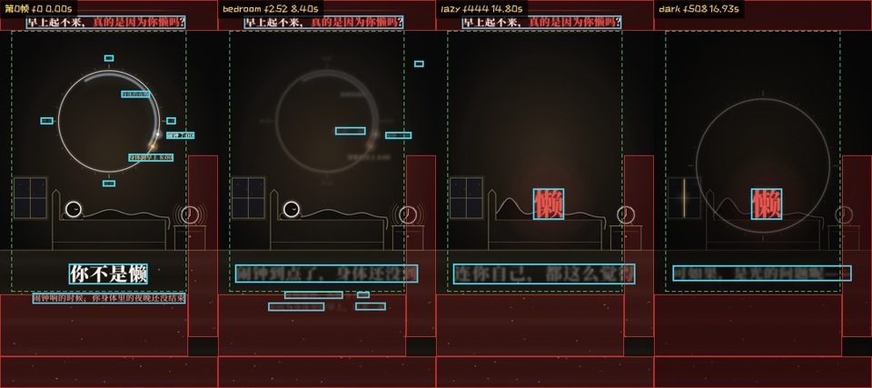

# video-lint

English · [中文](README.zh.md)

[](https://github.com/tz1335/video-lint/actions/workflows/ci.yml)

**Deterministic QA for finished short videos.** Point it at an mp4 and it checks the first frame and first two seconds, black and frozen stretches, text under TikTok / Reels / Shorts UI zones, cut-on-beat timing, loudness, and whether sound effects are buried under the music. It writes a human report, a JSON report for agents, and contact sheets. No model calls: same input, same answer.

It started inside a Remotion project that makes short explainer videos; every rule comes from a real published video and its retention data (the reasons are written next to each rule in `lint.py`).

## Install

```bash
pipx install "video-lint[ocr] @ git+https://github.com/tz1335/video-lint@v0.9.0"
video-lint final.mp4
```

`[ocr]` adds RapidOCR for the text checks on any video; drop it for a lighter install. `[beats]` adds librosa for estimating the beat grid from audio, `[glyphs]` fontTools for the `--font` missing-glyph check, `[mcp]` the MCP server; `[all]` installs everything. Plain `pip install` works the same way. Requires `ffmpeg` / `ffprobe` on PATH.

Without installing, from a clone: `pip install -r requirements.txt`, then `python -I lint.py final.mp4`.

## Quick start

```bash
video-lint final.mp4                                   # report in final-lint/
video-lint final.mp4 --platform tiktok --lufs -14 --strict
video-lint final.mp4 --captions final.srt          # caption reading speed and opening line
video-lint final.mp4 --sidecar examples/sidecar.example.json --out report/
```



*Part of a contact sheet: Douyin's UI zones in red, the recommended safe area dashed in green, detected text lines in cyan. The hook at the top sits under the top bar and the second caption line sits in the caption area, both flagged in `report.md`.*

Outputs (`--out`, default `<video>-lint/`): `report.html` (self-contained), `report.md` for people, `report.json` for agents, `sheet-*.jpg` contact sheets, `frame0.jpg`, `hits.jpg`, `curve.png`. See `SKILL.md` for every option, the sidecar format and how to read `report.json`. `SKILL.md` follows the Agent Skills format, so this folder can be dropped into any agent that supports skills.

Without a text layer, text is found with OCR when `[ocr]` is installed (it can miss tiny, stylised or low-contrast text, so "no text on frame 0" from OCR is only a warning).

## Sidecar from subtitles or an EDL

No sidecar yet? Build one from what your editor already exports: an `.srt` / `.vtt` / `.ass` subtitle file and, optionally, a CMX 3600 EDL (Premiere, Resolve and Final Cut all export one). fps, size and duration are read from the video with ffprobe.

```bash
video-lint-import final.mp4 --srt final.srt --edl final.edl -o final.sidecar.json
video-lint final.mp4 --sidecar final.sidecar.json --font MyFont.ttf
```

Subtitles become `captions` (reading speed, the opening line, the closing question, missing glyphs); EDL video events become named `shots` (record timecodes shifted so the first event starts at frame 0; names from `* FROM CLIP NAME`). Without an EDL the hard cuts are still found from the pixels, the report just has no shot names. Hits, sound effects and the beat grid have no standard export format, so add them to the JSON by hand if you want those checks (see `SKILL.md`). `examples/e2e.py` builds a 6-second captioned test video and runs the whole chain.

## Config file

Put a `.video-lint.toml` next to your videos (or any folder above them); command-line flags still win.

```toml
platform = "douyin"
lufs = -14
loud = ["impact", "chime"]      # sound effects that must be audible
captions = "final.srt"          # paths are relative to this file
ignore = ["static", "hit.*"]    # intentional — record only
[levels]
"spec" = "info"                 # change one check's level
```

## Cover check

```bash
video-lint final.mp4 --cover cover-3x4.png --cover cover-4x3.png
video-lint --cover cover-3x4.png          # covers only, no video
```

For each cover: size and aspect ratio; whether the largest line is still readable when shrunk to a list tile (portrait covers: a 3-column profile grid, about 130 CSS px wide; landscape: about 180 — estimates, change with `--cover-tile`), judged by text height in CSS pixels and by OCR on the shrunken image; which title-sized lines a centre crop to 1:1 (portrait) or 16:9 (landscape) would cut (recorded only — which pages crop like this hasn't been measured); text contrast. It also writes `cover-*.jpg`: the cover with crop and text boxes, next to the tile-size version.

## Why did viewers leave here?

Put your platform analytics in the sidecar's `performance` and the report gets a `retention.why` entry: for each window where viewers left — the first 2 seconds, valleys the platform marks, bounce peaks, and stretches where you lost viewers faster than similar videos — it lists what happened on screen and in the sound at that moment, looking 1 s further back for reaction time:

```
Platform valley 0.6–1.3 s
  - 0.73 s  animation mark draw
  - 0.80 s  frame got darker (22 → 15)
  - 1.07 s  animation mark flipEnd
Lost faster than peers 3–5 s: 13.3%/s vs 7.7%/s
  - 3.63 s  hit drop · entered shot lust · sound +9 dB
```

```jsonc
"performance": {
  "bounce2s": 0.413, "completion": 0.097,
  "valleys": [[0.6, 1.2]],                 // low points the platform marks
  "bouncePeaks": [[0.3, 1.0, 0.27, 0.23]], // [from, to, share, peers' share]
  "retention": [[3, 0.47], [6, 0.31]],     // points read off the curve
  "peers": [[2, 0.64], [6, 0.4]]           // similar videos
}
```

Events: hard cuts, shot changes, caption changes, hits, sound effects, `marks` (named animation beats from the sidecar), black and frozen stretches, the frame suddenly getting brighter or darker, the sound suddenly getting louder or quieter, the first sound. They are listed, not judged: with a handful of videos, which one caused the drop is for a person to decide. `report.json` also carries the whole event timeline (`events`) and opening features (`features.openEvents`, `firstCutSec`) for comparing videos.

## Fix loop

Every ✗ / ⚠ comes with a `fix` hint, and every run writes `fix.md`: the to-do list, failures first, each with where to edit and how. Fix, re-render, then check against the previous report:

```bash
video-lint final.mp4 --out r1/            # read r1/fix.md and edit
video-lint final.mp4 --out r2/ --compare r1/
```

Done when there is no ✗ and nothing new under `compare`. With the MCP server an agent runs the loop itself: `lint_video` → edit the files in `where` following `fix` → re-render → `verify_fix(video, previous=...)` until `done` is true.

## Errors that point at your source

If the sidecar says where each shot is drawn, every ✗ / ⚠ comes with a `file:line`, the way ESLint does:

```
✗ Text inside the Douyin caption zone: 17 frames covered
    → src/scenes/Bedroom.tsx:112 (shot bedroom, frames 0–252; timing in timeline.ts:152)
⚠ Cut off the beat at frame 1020
    → src/scenes/Split.tsx:370 (shot split, frame 1020; timing in timeline.ts:156)
```

Add `source` (where it is drawn) and `defined` (where its timing lives) to shots, `source` to hits / sfx / captions, and `sources.composition` as the fallback; paths are relative to the sidecar's `root`. `report.json` and the MCP tool return the same as `where: [{file, line, shot, from, to, timing, path}]`, so an agent can open the file and fix it. Code-driven video tools (Remotion and the like) can write these fields straight from their scene tables.

## Before / after

```bash
video-lint final_v2.mp4 --compare final_v1-lint/
```

Adds a `compare` check listing what was fixed, what is new and what is still there since the previous `report.json` (or its folder). New problems → ⚠.

## Shareable HTML report

Every run also writes `report.html`: one self-contained file with the images embedded, checks filterable by level. Send it to whoever needs to look.

## GitHub Action

```yaml
- uses: tz1335/video-lint@v0.9.0
  with:
    video: out/final.mp4
    args: --platform tiktok --lufs -14 --captions out/final.srt
    fail-on: fail        # fail | unmeasured | never
```

Installs ffmpeg and video-lint, writes the report to the job summary, uploads the report folder as an artifact, and exposes `status` and `report-dir` outputs.

## MCP server

```bash
pipx install "video-lint[mcp,ocr] @ git+https://github.com/tz1335/video-lint@v0.9.0"
claude mcp add video-lint -- video-lint-mcp
```

Tools: `lint_video(video, platform, lufs, captions, sidecar, sfx_audio, out, compare, ocr, flash, covers)` returns the status, every ✗ / ⚠ / ? check with its `where` and `fix`, and the report paths (including `fix.md`); `verify_fix(video, previous, ...)` re-checks a new render against the previous report and returns `fixed` / `added` / `still` and `done`; `list_platforms()` lists platforms with their zone and spec data. Works with Claude Code, Cursor and any other MCP client.

## Tests

```bash
pip install pytest
python -m pytest tests -q
```

The tests synthesise small videos with known answers using ffmpeg (a black first frame, a cut 2 frames off the beat, a darken → freeze → burst hit, text inside the Douyin caption zone, a sound effect buried under noise) and check that `report.json` says exactly that. CI runs them on Ubuntu (Python 3.10, 3.12) and Windows on every push.

## What it checks

| Check | Rule |
| ---|---|
| Frame 0 | near-black ✗; under 0.5% bright pixels ✗; clearly darker than 0.5–2 s (fade-in) ⚠|
| First 2 seconds | black frames ⚠; motion relative to the rest of the video (recorded)|
| Flashing (WCAG 2.3.1) | more than 3 general or red flashes in any second over a large area ✗ (area ≈ 11% of the frame, summed over the whole frame, slightly stricter than the standard); reversing patterns (checkerboards, stripes) are caught by the same check as long as each cell is wider than about 1% of the frame|
| Upload spec | codec, pixel format, frame rate, resolution, aspect for the `--platform`, duration limit, audio codec and sample rate ⚠ (low bitrate is only a hint); recommended values in `video_lint/specs.json`|
| Caption reading speed | more than 9 CJK characters or 20 Latin characters per second, or on screen for under 5/6 s ⚠ (Netflix timed-text guidelines); captions from the sidecar or `--captions file.srt / .vtt / .ass`|
| Black / frozen | black runs mid-video ⚠; frozen ≥ 1 s in the first 3 s ⚠|
| Hits (with sidecar) | darken before, freeze N frames, burst after|
| Cut on beat | hard cuts more than ±1.5 frames off the grid ⚠ / ✗|
| Phone speaker (mono) | summed to mono, the whole video drops more than 4.5 dB, or any half second drops more than 9 dB ⚠ (ordinary stereo drops about 3 dB); reports the L/R correlation|
| Loudness jumps | 15 dB or more louder within a second ⚠ (EBU R128 loudness jump, unweighted approximation); rises out of silence and on sidecar hits don't count|
| Dead air | 1 s or more below −50 dBFS mid-video ⚠ (the first 0.3 s and last 1 s don't count)|
| Loudness | true peak > −1 dBFS ⚠, > 0 ✗; integrated LUFS only when `--lufs` is given|
| Sound effects | full-band or 1.2–5 kHz rise over the moment before; or, with a stem, effect-to-music ratio, and `fix.md` says how many dB each buried effect needs |
| Text contrast (WCAG 1.4.3) | large text under 3:1 against what is behind it ⚠; 3:1–4.5:1 noted; text under 3% of the frame height is counted, not judged. Each text box is measured on the sampled frame and 0.4 s earlier (the clearer one wins), so text fading out at a cut is not flagged|
| Text | glyphs under a platform UI zone ✗ / ⚠; text touching the frame edge ⚠; text size recorded. Text boxes come from a text layer (`--text-dir`) or, without one, from OCR (`pip install rapidocr-onnxruntime`, any OS)|
| Closing question | the last screen is a question (ends in `?`, or asks "which would you pick") and stays readable ≥ 2 s before any fade or black ⚠; needs captions |
| Missing glyphs | with `--font`, caption characters that none of the fonts has (they would silently fall back to a system font) ⚠; needs `[glyphs]` |
| Opening rules | frame 0 has text big enough to read; a hook in the top half (portrait); a number within 8 s|

## Thresholds

Every threshold, where it comes from (a standard, an engineering estimate, or the author's own N videos), the sample size and whether it is significant is listed in [`THRESHOLDS.md`](THRESHOLDS.md). Most rules are **uncalibrated**: the author's sample is under 10 videos and nothing in it is statistically significant yet.

## Platforms

UI zone data ships for three platforms (`--platform`, data in `video_lint/zones.json`); the numbers come from [reelsmith/safezone](https://github.com/reelsmith/safezone) and are approximations averaged over recent iOS and Android phones.

| `--platform` | Platform | Status |
| ---|---|---|
| `tiktok` / `douyin` | TikTok / 抖音 | supported; Douyin reuses the TikTok numbers (same layout)|
| `reels` | Instagram Reels | supported |
| `shorts` | YouTube Shorts | supported |
| `none` | — | no zones (landscape, or any other player)|

Other platforms where the same checks are useful. Everything except the UI zones already works on them today; adding a platform only needs its zone rectangles in `video_lint/zones.json` (measure a screenshot of the feed on a phone).

| Platform | Feed format | Notes |
| ---|---|---|
| Kuaishou | 9:16 | layout broadly like Douyin; zones not measured yet|
| WeChat Channels | 9:16, also landscape | zones not measured yet|
| Xiaohongshu | 3:4 and 9:16 | 3:4 is the native card ratio; video notes also play 9:16|
| Bilibili | 16:9 (main), 9:16 (Story mode) | landscape has few overlays; the vertical Story feed has a right rail|
| Facebook Reels | 9:16 | layout broadly like Instagram Reels; zones not measured yet|
| Snapchat Spotlight | 9:16 | zones not measured yet|
| Pinterest (video pins) | 2:3, 9:16 | zones not measured yet|
| LinkedIn / X (Twitter) video | 1:1, 4:5, 16:9 | in-feed autoplay starts muted, so the first frame and burned-in captions matter even more|

## Status and exit codes

`pass` (0) · `fail` (2) · `unmeasured` (3: something could not be checked — not a pass). Exit code 1 is reserved for crashes.

## License

MIT (see `LICENSE`). Platform UI zone data from [reelsmith/safezone](https://github.com/reelsmith/safezone), MIT — see `THIRD_PARTY.md`.
