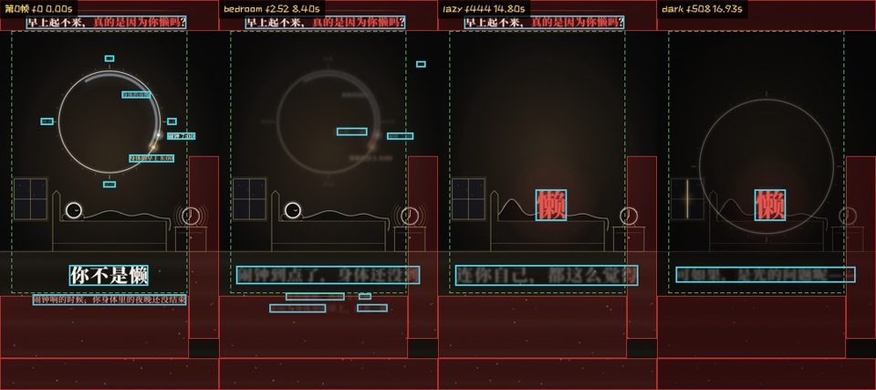

# video-lint

[English](README.md) · 中文

[](https://github.com/tz1335/video-lint/actions/workflows/ci.yml)

**短视频成片质检，规则全是确定性的。** 给它一个 mp4，它会查第 0 帧和前 2 秒、黑场和静止画面、字幕有没有被抖音（TikTok）/ Reels / Shorts 的界面挡住、硬切卡不卡拍、响度，以及音效有没有被配乐盖住。输出给人看的报告、给 agent 读的 JSON 报告和联系表。不调用任何模型：同样的输入，永远得到同样的结论。

它最早是在一个用 Remotion 做知识短视频的工程里写出来的。每一条规则都来自一支真实发布过的视频和它的留存数据，`lint.py` 里每条规则旁边都写了来由。

## 安装

```bash
pipx install "video-lint[ocr] @ git+https://github.com/tz1335/video-lint@v0.9.0"
video-lint final.mp4
```

`[ocr]` 会装上 RapidOCR，对任何视频都能做文字检查；不要的话去掉它，装起来更轻。`[beats]` 装 librosa，用来从音频估拍子网格；`[glyphs]` 装 fontTools，给 `--font` 缺字检查用；`[mcp]` 装 MCP 服务；`[all]` 全都装。用普通的 `pip install` 也一样。需要 `ffmpeg` / `ffprobe` 在 PATH 里。

不想安装的话，克隆仓库后 `pip install -r requirements.txt`，再 `python -I lint.py final.mp4` 也能跑。

## 快速开始

```bash
video-lint final.mp4                                   # report in final-lint/
video-lint final.mp4 --platform tiktok --lufs -14 --strict
video-lint final.mp4 --captions final.srt          # 字幕阅读速度和开头第一句
video-lint final.mp4 --sidecar examples/sidecar.example.json --out report/
```



*联系表的一部分：红框是抖音界面遮挡区，绿色虚线是推荐安全区，青框是识别出的文字行。顶部的钩子压在顶栏下面，第二行小字幕落在文案区里，`report.md` 里都判了出来。*

输出（`--out`，默认 `<视频名>-lint/`）：单文件的 `report.html`、给人看的 `report.md`、给 agent 读的 `report.json`、联系表 `sheet-*.jpg`、`frame0.jpg`、`hits.jpg`、`curve.png`。全部参数、旁注格式、`report.json` 怎么读，见 `SKILL.md`。`SKILL.md` 按 Agent Skills 格式写，整个目录可以直接放进任何支持 skill 的 agent 里用。

没有文字层时，装了 `[ocr]` 就用 OCR 找字（很小、艺术字、低对比的字可能漏掉，所以 OCR 判出的「第 0 帧没有字」只给 ⚠）。

## 从字幕或 EDL 生成旁注

还没有旁注？用剪辑软件本来就能导出的东西生成：`.srt` / `.vtt` / `.ass` 字幕，外加可选的 CMX 3600 EDL（Premiere、达芬奇、Final Cut 都能导）。帧率、分辨率和时长用 ffprobe 从成片读。

```bash
video-lint-import final.mp4 --srt final.srt --edl final.edl -o final.sidecar.json
video-lint final.mp4 --sidecar final.sidecar.json --font MyFont.ttf
```

字幕变成 `captions`（阅读速度、开头第一句、片尾问句、缺字）；EDL 里的视频事件变成带名字的 `shots`（录制时间码整体平移到从第 0 帧开始，名字来自 `* FROM CLIP NAME`）。没有 EDL 也能跑：硬切照样从画面里找，只是报告里没有镜头名。爆点、音效、拍子网格没有通用的导出格式，要查这几项就手动写进 JSON（见 `SKILL.md`）。`examples/e2e.py` 会合成一段 6 秒带字幕的测试视频，把整条链路跑一遍。

## 配置文件

把 `.video-lint.toml` 放在视频所在目录或者上层任意目录，video-lint 会自动找到；命令行参数优先于配置文件。

```toml
platform = "douyin"
lufs = -14
loud = ["impact", "chime"]      # 要听得见的音效
captions = "final.srt"          # 路径相对配置文件
ignore = ["static", "hit.*"]    # 故意为之的，只记录
[levels]
"spec" = "info"                 # 改单项检查的级别
```

## 封面检查

```bash
video-lint final.mp4 --cover cover-3x4.png --cover cover-4x3.png
video-lint --cover cover-3x4.png          # 只查封面
```

每张封面查：尺寸和画幅；缩到列表格子里最大那行字还读不读得清（竖封面按主页一行 3 格、一格约 130 CSS 像素宽，横封面约 180，都是估计值，可以用 `--cover-tile` 改），按字高的 CSS 像素和缩小后 OCR 能不能读回来两样判；居中裁成 1:1（竖封面）或 16:9（横封面）会切到哪些标题级的字（只记录，哪些页面这样裁还没实测）；文字对比度。还会出一张 `cover-*.jpg`：原图画上裁切框和文字框，旁边是格子大小的样子。

## 留存归因

把平台后台的数据写进旁注的 `performance`，报告里会多一条 `retention.why`：每个掉人的时间窗（开头 2 秒、平台标的低谷、跳出峰、比同类掉得快的段）里，画面和声音发生了什么。人看到问题到划走有反应时间，所以每个窗口往前多看 1 秒：

```
Platform valley 0.6–1.3 s
  - 0.73 s  animation mark draw
  - 0.80 s  frame got darker (22 → 15)
  - 1.07 s  animation mark flipEnd
Lost faster than peers 3–5 s: 13.3%/s vs 7.7%/s
  - 3.63 s  hit drop · entered shot lust · sound +9 dB
```

```jsonc
"performance": {
  "bounce2s": 0.413, "completion": 0.097,
  "valleys": [[0.6, 1.2]],                 // 平台标的低谷（秒）
  "bouncePeaks": [[0.3, 1.0, 0.27, 0.23]], // 跳出分析里的峰
  "retention": [[3, 0.47], [6, 0.31]],     // 曲线上抄的点
  "peers": [[2, 0.64], [6, 0.4]]           // 同类作品
}
```

事件包括：硬切、进镜头、换字幕、爆点、音效、`marks`（旁注里带名字的动画节拍）、黑场、静止、画面突然变亮 / 变暗、声音突然变大 / 变小、第一声。只列不判：几期的样本说不清哪个是原因，要人来看。`report.json` 里还有完整的事件表（`events`）和开头特征（`features.openEvents`、`firstCutSec`），方便跨期对照。

## 闭环修复

每个 ✗ / ⚠ 都带一条 `fix`（改法），每次运行还会写一份 `fix.md`：要改的清单，✗ 在前，每项写明改哪里、怎么改。改完重新导出，再和上一版比：

```bash
video-lint final.mp4 --out r1/            # 照 r1/fix.md 改
video-lint final.mp4 --out r2/ --compare r1/
```

没有 ✗、`compare` 里也没有「新出现」，这一轮就算改完了。接上 MCP 之后 agent 可以自己跑这个循环：`lint_video` → 按 `fix` 改 `where` 指的文件 → 重新渲染 → `verify_fix(video, previous=...)`，直到 `done` 为真。

## 报错直接指到源码

旁注里写了每个镜头在哪画，每个 ✗ / ⚠ 都会带上 `file:line`，像 ESLint 指到行号那样：

```
✗ Text inside the Douyin caption zone: 17 frames covered
    → src/scenes/Bedroom.tsx:112 (shot bedroom, frames 0–252; timing in timeline.ts:152)
⚠ Cut off the beat at frame 1020
    → src/scenes/Split.tsx:370 (shot split, frame 1020; timing in timeline.ts:156)
```

给镜头加 `source`（在哪画）和 `defined`（时间写在哪），给爆点、音效、字幕加 `source`，再给一个 `sources.composition` 兜底；路径相对旁注里的 `root`。`report.json` 和 MCP 工具里同样有 `where: [{file, line, shot, from, to, timing, path}]`，agent 拿到就能打开文件去改。Remotion 这类用代码做视频的工具，可以直接从场景表写出这些字段。

## 和上一版比

```bash
video-lint final_v2.mp4 --compare final_v1-lint/
```

加一项 `compare` 检查，列出和上一版 `report.json`（或报告目录）相比修好了什么、新出现了什么、还剩什么；有新问题就 ⚠。

## 可以直接发的 HTML 报告

每次运行都会额外生成 `report.html`：图片全部嵌在一个文件里，能按级别筛选检查项。发给谁都能直接打开看。

## GitHub Action

```yaml
- uses: tz1335/video-lint@v0.9.0
  with:
    video: out/final.mp4
    args: --platform tiktok --lufs -14 --captions out/final.srt
    fail-on: fail        # fail | unmeasured | never
```

会自动装 ffmpeg 和 video-lint，把报告写进 Actions 的摘要页，把报告目录作为附件上传，并提供 `status` 和 `report-dir` 两个输出。

## 给 agent 用

```bash
pipx install "video-lint[mcp,ocr] @ git+https://github.com/tz1335/video-lint@v0.9.0"
claude mcp add video-lint -- video-lint-mcp
```

工具：`lint_video` 返回整体状态、所有 ✗ / ⚠ / ? 的检查（带位置 `where` 和改法 `fix`）和报告路径（包括 `fix.md`）；`verify_fix` 改完后重新检查并和上一版比，返回修好、新出现、还在的问题和 `done`；`list_platforms` 列出支持的平台和它们的遮挡区、规格数据。Claude Code、Cursor 和其它支持 MCP 的客户端都能用。

## 测试

```bash
pip install pytest
python -m pytest tests -q
```

测试用 ffmpeg 现场合成已知答案的小视频（第 0 帧黑屏、偏离拍点 2 帧的硬切、收暗 → 静止 → 爆亮的爆点、落在抖音文案区里的字、被噪声盖住的音效），核对 `report.json` 的结论和预期完全一致。每次推送都会在 Ubuntu（Python 3.10、3.12）和 Windows 上自动跑一遍。

## 查什么

| 检查 |规则 |
| ---|---|
| 第 0 帧 | 近乎全黑 ✗；亮像素不到 0.5% ✗；明显比 0.5–2 秒暗（淡入开场）⚠ |
| 前 2 秒 | 有黑帧 ⚠；运动量和全片相比的倍数（只记录） |
| 闪烁安全 | 任意 1 秒内大面积闪烁或红色闪烁超过 3 次 ✗（面积约占画面 11%，按整帧累加，比标准略严）。可能诱发光敏性癫痫。棋盘格、条纹这类反转图案也由这一项抓，格子宽度大于画面约 1% 就行 |
| 上传规格 | 编码、像素格式、帧率、分辨率、对应 `--platform` 的画幅、时长上限、音频编码和采样率 ⚠（码率偏低只提示）；推荐值在 `video_lint/specs.json` |
| 字幕阅读速度 | 中文每秒超过 9 个字、英文每秒超过 20 个字符，或停留不到 5/6 秒 ⚠（Netflix 字幕规范）；字幕来自旁注，或 `--captions` 直接读 SRT / VTT / ASS |
| 黑场和静止 | 片中黑场 ⚠；前 3 秒有 1 秒以上不动 ⚠ |
| 爆点（需要旁注） | 爆点前收暗、最后 N 帧静止、爆点后亮起 |
| 硬切卡拍 | 硬切离拍点超过 ±1.5 帧 ⚠ / ✗ |
| 手机外放 | 左右声道混成单声道后整片小了 4.5 dB 以上，或某半秒小了 9 dB 以上 ⚠（普通立体声约小 3 dB）；同时记录左右声道相关系数。手机外放和很多蓝牙小音箱是单声道，反相的声音会被抵消 |
| 响度突增 | 1 秒内突然响 15 dB 以上 ⚠（EBU R128 的响度跳变，用没加权的电平近似）；从静音起来的、落在旁注爆点上的不算 |
| 静音空档 | 片中 1 秒以上低于 −50 dBFS ⚠（开头 0.3 秒、最后 1 秒不算） |
| 响度 | 真峰值高于 −1 dBFS ⚠、高于 0 ✗；给了 `--lufs` 才判整片响度 |
| 音效 | 比前一刻高出多少（全频或 1.2–5 kHz）；有音效分轨时改用音效和配乐的能量比，`fix.md` 写明每个被埋的音效要补多少 dB |
| 文字对比度 | 大字和背景的对比度低于 3:1 ⚠，3:1–4.5:1 记录；字高不到画面 3% 的小字只数不判。每个文字框在抽样帧和 0.4 秒前各量一次，取清楚的那次，镜头切走前正在淡出的字不会误报 |
| 文字 | 字被平台界面挡住 ✗ / ⚠；文字贴边 ⚠；字高只记录。文字框来自文字层（`--text-dir`），没有文字层时用 OCR 自动找（`pip install rapidocr-onnxruntime`，Windows / Mac / Linux 都能用） |
| 片尾问句 | 最后一屏是问句（问号结尾，或「你会选哪个」这类问法），在淡出 / 黑场前看得清 ≥ 2 秒，否则 ⚠；要有字幕 |
| 缺字 | 给了 `--font` 时，字幕里有字所有字体都没有（会悄悄换成系统字体）⚠；要装 `[glyphs]` |
| 开头规则 | 第 0 帧有够大的字；竖屏上半屏有钩子；8 秒内出现数字 |

## 阈值

每个阈值的出处（规范、工程经验，还是作者自己的 N 期视频）、样本量、是否显著，都列在 [`THRESHOLDS.md`](THRESHOLDS.md)。大部分规则 **未校准**：作者的样本不到 10 期，目前没有一条统计显著。

## 平台

自带三个平台的界面遮挡区数据（`--platform`，数据在 `video_lint/zones.json`），数字取自 [reelsmith/safezone](https://github.com/reelsmith/safezone)，是近几年 iOS 和安卓手机的平均近似值。

| `--platform` |平台 |状态 |
| ---|---|---|
| `tiktok` / `douyin` | TikTok / 抖音 | 已支持；抖音界面和 TikTok 布局相同，直接沿用 TikTok 的数字 |
| `reels` | Instagram Reels |已支持 |
| `shorts` | YouTube Shorts |已支持 |
| `none` | — | 不画遮挡区（横屏视频，或其它播放器） |

下面这些平台同样用得上。除了界面遮挡区，其它检查现在就能直接用；要加一个平台，只需要在 `video_lint/zones.json` 里补上它的遮挡区矩形（拿手机截一张信息流的图量出来）。

| 平台 |主要画幅 |说明 |
| ---|---|---|
| 快手 | 9:16 | 布局大体和抖音相近，遮挡区还没量 |
| 微信视频号 | 9:16, also landscape | 遮挡区还没量 |
| 小红书 | 3:4 and 9:16 | 3:4 是笔记封面原生比例，视频笔记也播 9:16 |
| B 站 | 16:9 (main), 9:16 (Story mode) | 横屏基本没有遮挡；竖屏 Story 模式有右侧按钮列 |
| Facebook Reels | 9:16 | 布局大体和 Instagram Reels 相近，遮挡区还没量 |
| Snapchat Spotlight | 9:16 | 遮挡区还没量 |
| Pinterest (video pins) | 2:3, 9:16 | 遮挡区还没量 |
| LinkedIn / X (Twitter) video | 1:1, 4:5, 16:9 | 信息流里默认静音自动播放，第 0 帧和压在画面上的字幕更关键 |

## 状态和退出码

`pass`（0）通过 · `fail`（2）有问题 · `unmeasured`（3）有该查但查不了的项，不算通过。退出码 1 留给脚本自己出错。只有加了 `--strict` 才按状态给退出码。

## 许可

MIT 许可（见 `LICENSE`）。平台遮挡区数据来自 [reelsmith/safezone](https://github.com/reelsmith/safezone)，同为 MIT 许可，见 `THIRD_PARTY.md`。
